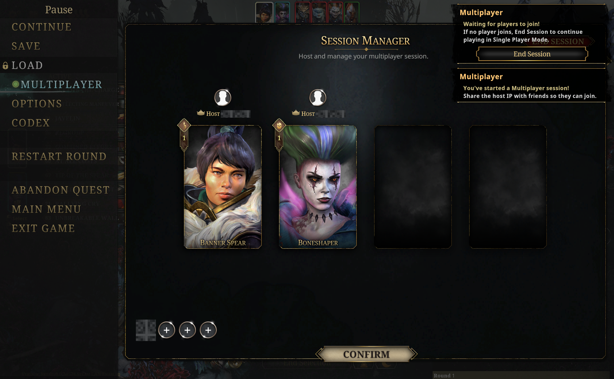
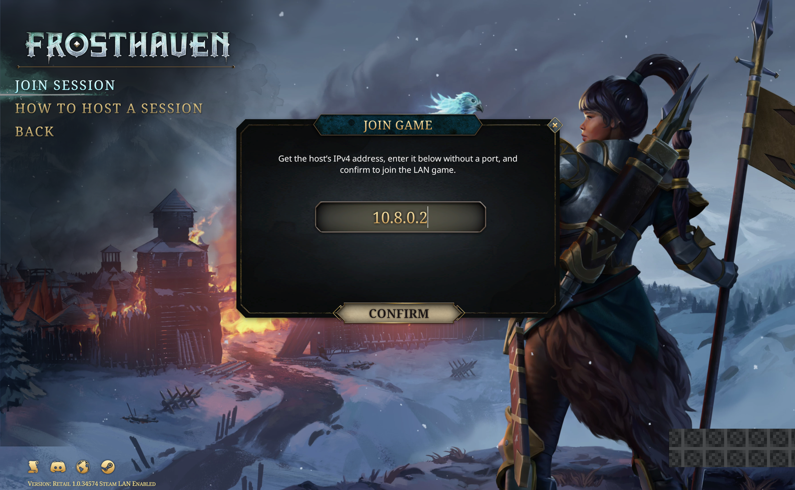

> [!CAUTION]
> **Antivirus false-positive warning**
> This tool injects DLLs into the game process and patches code in memory, so antivirus software may flag it. Official Release binaries are built by this repository's GitHub Actions from the corresponding source tag; this is not a guarantee of safety. If you are concerned about malware, read the source yourself or ask AI to help review it, then compile it on your own machine. If you are still uncomfortable, do not use this tool. Do not disable your antivirus to use it.

# Frosthaven LAN

[简体中文](README.zh-CN.md)

## Introduction

A third-party launcher for Frosthaven that forces LAN multiplayer mode.

Frosthaven uses invite codes and peer-to-peer connections for multiplayer. Poor connections can cause several disconnects in one session, even with a gaming VPN. I built this tool with AI so I could play with friends. It lets the game send multiplayer traffic over an existing virtual LAN when players are on different networks.

The launcher enables the game's built-in ENet backend through in-memory injection. It leaves game installation files, saves, and Steam achievements untouched. To play as usual, launch the game from Steam.

The latest supported version is **Retail 1.0.34574 Steam** (build `26755354`). You can try it with newer versions, which may still work if the game's multiplayer implementation remains compatible. If you run into a problem, please open an issue.

See [PRODUCT.md](https://github.com/Blacktea0/frosthaven-lan/blob/main/PRODUCT.md) in the repository for technical details and troubleshooting.

## How to use

1. **Install and sign in to Steam**, and confirm the game launches normally. Both players need the same game and patch version.
2. Download the ZIP from [Releases](https://github.com/Blacktea0/frosthaven-lan/releases/latest) and **extract all files** into a writable folder. Do not copy only the EXE.
3. Choose a startup mode: **double-click** `frosthaven-lan.exe` normally to launch the game EXE directly, or **right-click → Run as administrator if you need the Steam in-game overlay**, which launches the game through Steam. **The game must be started by this tool.** If it is already running, close all game instances manually, then reopen the tool.
4. Wait for the message confirming successful injection and forced LAN mode. The host loads a campaign and opens multiplayer from the pause menu, then shares their LAN IPv4 address when prompted.
5. The client selects Multiplayer → Join Session and enters the host IPv4 address (for example `192.168.1.20`, without a port). The host assigns characters and confirms.

Keep all five runtime files together: `frosthaven-lan.exe`, `LanBridge.dll`, `Bootstrap.dll`, `LanPayload.dll`, and `0Harmony.dll`. The ZIP contains these five files and `Harmony-LICENSE.txt`.

To enable the **Steam in-game overlay**, launch this tool as administrator. Standard mode starts the game EXE directly; both modes require the tool to start the game.

Standard mode checks the current Steam login session before starting the game. If it cannot confirm sign-in, open Steam and sign in before retrying, or use administrator mode to launch through Steam.

The game uses **UDP 30000** for multiplayer. Make sure your firewall allows traffic on that port.

### Screenshots

The multiplayer notification prompts the host to share their LAN IPv4 address with friends.



The joining player enters the host's IPv4 address. The screenshot uses `10.8.0.2` as an example.



## Development requirements

- Windows x64.
- Rust stable, using your configured default toolchain with either setup:
  - MSVC: `x86_64-pc-windows-msvc` plus Visual Studio C++ Build Tools and the Windows SDK (including `kernel32.lib`).
  - GNU: `x86_64-pc-windows-gnu` plus MinGW-w64/GCC, with `gcc` and `windres` on PATH.
- Windows .NET Framework C# compiler: `C:\Windows\Microsoft.NET\Framework64\v4.0.30319\csc.exe`.
- Windows PowerShell for ZIP packaging.

Harmony 2.3.3 is included. Building does not require the game; live injection tests require the supported game and Steam environment.

## Building and development

Run from the repository root. Close the game before rebuilding.

```text
cargo xtask build           # Build the production runtime in dist/
cargo xtask package         # Write production ZIP and SHA256 to artifacts/
cargo xtask run             # Build and run using the terminal's permission level
```

There is one runtime: standard terminals launch the game directly; administrator terminals launch it through Steam. Use `xtask` for the complete runtime; `cargo build` alone builds only Rust components.

```text
cargo fmt --all -- --check
cargo test --workspace --locked
cargo xtask test-managed
```
