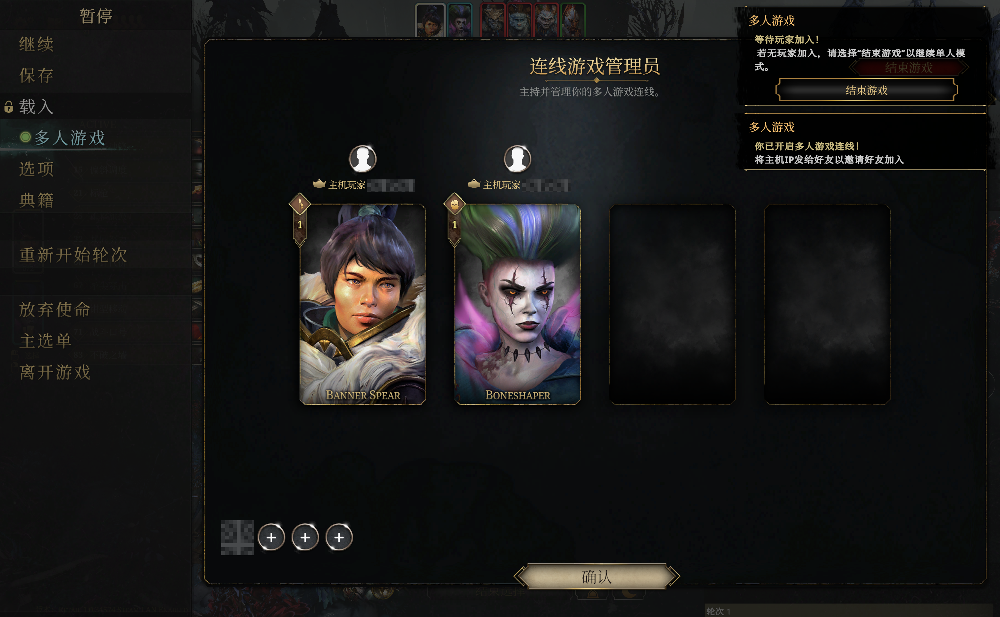
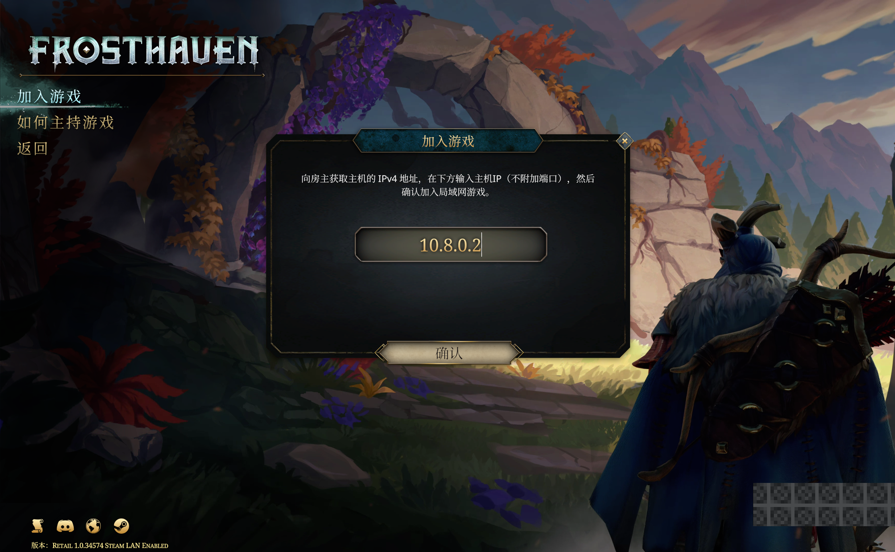

> [!CAUTION]
> **杀毒软件误报警告**
> 本工具需要向游戏进程注入 DLL 并在内存中打补丁，因此可能被杀毒软件误判。官方 Release 二进制包由本仓库的 GitHub Actions 从对应 tag 的源码构建；这不代表绝对安全。如果担心病毒，请自行阅读源码，或让 AI 辅助审查，然后在自己的机器上编译。如果仍然不放心，请不要使用。不要为了使用本工具而关闭杀毒软件。

# Frosthaven LAN

[English](README.md)

## 简介

这是一个霜港迷城(Frosthaven)的第三方启动器，用于强制开启局域网联机模式。

由于官方并不支持强制局域网联机，而是使用了邀请码+P2P的方式，导致在网络连通性不好的情况下经常一局游戏会掉线很多次，即便开了加速器也不能保证100%不掉线。这个东西是为了方便我跟朋友联机，用AI整出来的局域网联机工具。通过这个工具，就能使用现有的异地组网工具来实现局域网联机，在使用这个工具之前，你的流量并不会经过组网转发。

这个工具实现方式是通过内存注入启用游戏内置的 ENet 后端，不会修改游戏安装文件，也不影响存档以及Steam成就。如果不需要这个工具了，你只需要跟往常一样通过Steam打开游戏即可。

当前适配版本至 **Retail 1.0.34574 Steam**（构建号 `26755354`），在这之后的版本可以尝试用这个工具启动，如果官方对联机的功能没有太大改动的话应该还是能够正常使用的。如果无法正常使用，欢迎提Issue，我看到会修。

技术细节和故障排查见仓库中的 [PRODUCT.md](https://github.com/Blacktea0/frosthaven-lan/blob/main/PRODUCT.md)。

## 如何使用

1. **安装并登录 Steam**，确认游戏可以正常启动。双方使用相同的游戏版本和补丁。
2. 从 [Releases](https://github.com/Blacktea0/frosthaven-lan/releases/latest) 下载 ZIP，**完整解压**到可写目录，不要只复制 EXE。
3. 选择启动方式：**普通双击** `frosthaven-lan.exe`，工具会直接启动游戏本体；**需要 Steam 游戏内叠加界面时，右键 → 以管理员身份运行**，工具会通过 Steam 启动游戏。**必须由本工具启动游戏**；如果检测到游戏已运行，请手动关闭所有游戏实例，再重新打开本工具。
4. 等待提示“网络组件注入成功，强制局域网联机模式已开启”。房主载入战役，从暂停菜单进入“多人游戏”开房，按提示把自己的局域网 IPv4 地址发给其他玩家。
5. 客户端选择“多人游戏 → 加入游戏”，输入房主 IPv4（例如 `192.168.1.20`，不带端口）；房主分配角色并确认。

请将五个运行文件保存在同一目录：`frosthaven-lan.exe`、`LanBridge.dll`、`Bootstrap.dll`、`LanPayload.dll` 和 `0Harmony.dll`。ZIP 仅包含这五个文件和 `Harmony-LICENSE.txt`。

如需开启 **Steam 游戏内叠加界面**，请使用管理员模式启动本工具。普通模式直接启动游戏本体；两种模式均由工具启动游戏。

普通模式会在启动游戏前检查 Steam 当前登录会话；若未确认登录，请先打开 Steam 并完成登录后重试，或使用管理员模式通过 Steam 启动。

游戏联机网络使用 **UDP 30000** 通信，请确保防火墙没有封禁对应端口。

### 界面截图

开房成功后，多人游戏通知会提示房主将自己的局域网 IPv4 地址发给好友。



加入游戏的玩家输入房主的 IPv4 地址。截图以 `10.8.0.2` 为例。



## 开发环境需求

- Windows x64。
- Rust stable，沿用本机默认工具链，支持以下任一组合：
  - MSVC：`x86_64-pc-windows-msvc`，配套 Visual Studio C++ Build Tools 和 Windows SDK（包含 `kernel32.lib`）。
  - GNU：`x86_64-pc-windows-gnu`，配套 MinGW-w64/GCC，确保 `gcc` 和 `windres` 在 PATH 中。
- Windows .NET Framework C# 编译器：`C:\Windows\Microsoft.NET\Framework64\v4.0.30319\csc.exe`。
- 系统 PowerShell，用于 ZIP 打包。

Harmony 2.3.3 已包含在仓库中。编译无需安装游戏；实际注入测试需要支持版本的游戏及 Steam 环境。

## 如何编译开发

在项目根目录执行，重建前先退出游戏。

```text
cargo xtask build           # Build the production runtime in dist/
cargo xtask package         # Write production ZIP and SHA256 to artifacts/
cargo xtask run             # Build and run using the terminal's permission level
```

只有一个运行版本：普通终端直接启动游戏，管理员终端通过 Steam 启动。请使用 `xtask` 生成完整运行包，`cargo build` 仅构建 Rust 部分。

```text
cargo fmt --all -- --check
cargo test --workspace --locked
cargo xtask test-managed
```
